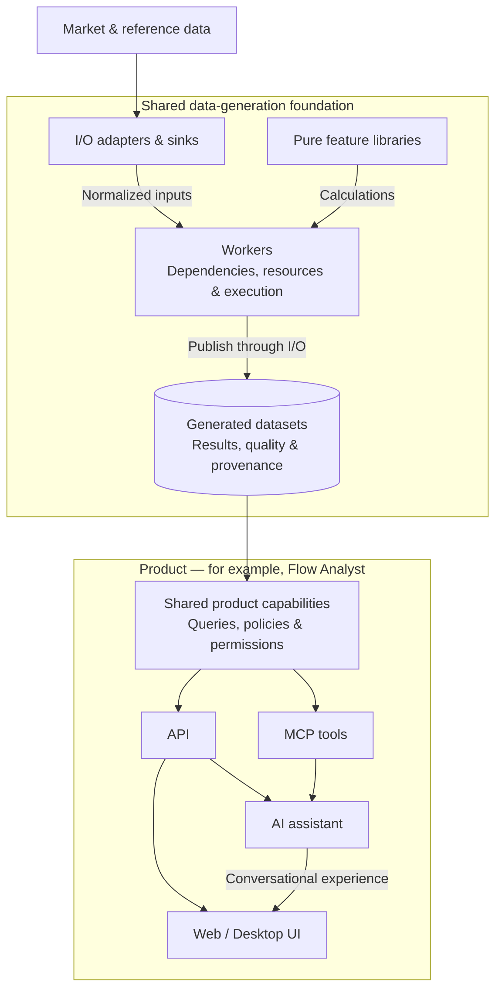

# High-level analyst product map

Owner discussion, October 19, 2026. This is product-definition guidance under [GOV-033](https://github.com/atulsrivas1/equity-features/issues/525). It records purposes and responsibility boundaries, not selected screens, intraday/EOD workflows, new release commitments or completed applications. Existing release scope and live Project statuses remain unchanged.

## Product purposes

| Product | High-level purpose |
| --- | --- |
| Flow Analyst | Understand trading activity, its concentration and changes across stocks, options and ETFs where data is admitted |
| Exposure Analyst | Understand exposure concentrations and sensitivities under explicit position, model and sign assumptions |
| Volatility Analyst | Understand realized and implied volatility, move scales and comparisons across instruments and horizons |
| Equity Analyst | Understand individual stocks through technicals, price patterns, relative strength, screening and watchlists |
| Market Analyst | Understand market breadth, sector/industry participation, leadership and benchmark comparisons |
| Event Analyst | Understand earnings, corporate actions, insider activity, short interest and other company-event context |
| Research Analyst | Explore strategy definitions, historical signals, persistence and subsequent observed outcomes |

The first three application names were discussed explicitly. The latter four remain proposed product boundaries supported by the inventoried families; Market/Event analysis may instead be modules. This map does not prove that every inventory entry has been assigned. Product overlap is valid: calculate compatible shared features once rather than duplicate their mathematics for each application. Operational I/O, workers, contracts, quality, evidence and provenance are shared foundations, not extra analyst products.

## Watchlists

Watchlists are capabilities within the relevant products, rather than a separate product by default.

| Watchlist focus | Product home |
| --- | --- |
| Stock technicals and stock screens | Equity Analyst |
| Trading activity and unusual-flow candidates | Flow Analyst |
| Exposure concentrations and levels | Exposure Analyst |
| Volatility conditions and selected comparisons | Volatility Analyst |
| Company events | Event Analyst |

A shared watchlist capability can combine selections from multiple products while retaining each selection's meaning and evidence. This is a high-level capability direction; detailed membership rules, user controls, persistence, sharing and UI behavior are not settled here. Do not infer that a named policy catalogue or cross-product watchlist application is implemented by the existing generic scanner package.

## Strategies

Strategies can consume features across products, for example equity momentum together with option activity and volatility context. Research Analyst is the proposed home for strategy definition/exploration and historical evaluation. Relevant analyst products can display current matching candidates; they need not duplicate the strategy mathematics or become separate strategy evaluators.

Historical labels and subsequent outcomes support research; future observations cannot become prerequisites for a current signal. The existing scope does not establish a complete execution simulator, transaction-cost/portfolio engine, profitability claim or automated trading service. Automated trade execution is a separate product scope.

## Shared responsibilities

I/O reads/normalizes and publishes data; pure feature libraries calculate from supplied facts; workers coordinate data-generation dependencies/resources/recovery/publication. Product backends/query layers consume admitted generated datasets and the UI presents them. Products may request jobs and share compatible datasets. Library boundaries do not mandate separate processes or per-product recomputation.

## High-level product architecture

A product delivers a coherent set of user capabilities through an API, MCP tools, an AI assistant and web/desktop interfaces, backed by shared generated data and domain logic. These are complementary surfaces of the same product and share definitions, permissions, availability and evidence.

Flow Analyst, Exposure Analyst and Volatility Analyst can use this structure while sharing compatible datasets and libraries. The arrows show conceptual data/capability flow, not exact runtime calls or a mandatory process/service topology. Workers invoke pure calculations; product services can request worker jobs. UI and assistant surfaces use shared product capabilities rather than duplicate feature mathematics. This diagram records product direction, not delivered API/MCP/assistant/UI scope or a deployment selection.

## Level of discussion

The owner clarified that the current discussion is high-level product definition. Screens, detailed feature allocation, intraday/EOD workflow, cadence/SLA, datasets and implementation decisions are deferred, not unanswered prerequisites that must be forced now. Continue with product purpose, boundaries, overlap, watchlists and strategy placement one product at a time. The [Flow Analyst note](FLOW_ANALYST_PRODUCT.md) retains its initial-market and data-availability distinctions.
